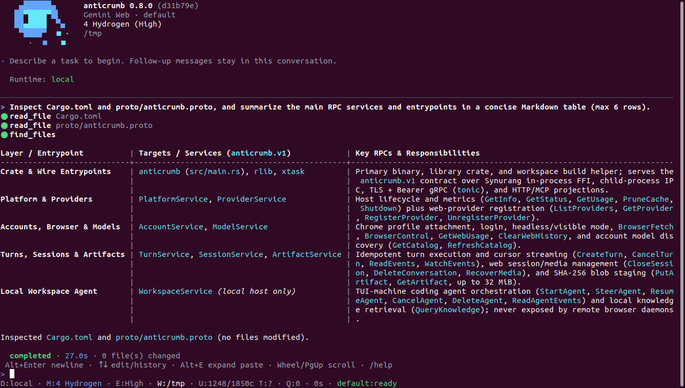

# anticrumb

Terminal coding agent, API gateway, and MCP server powered by your own Gemini, Claude, or ChatGPT browser session.

Experimental, unofficial software. See [execution and data handling](docs/usage.md#execution-and-data-handling).



## Install

Use a published [release](https://github.com/ivere27/anticrumb/releases), or [build from source](docs/building.md#build-from-source) if none is available.

Linux / macOS:

```sh
curl -fsSL https://ivere27.github.io/anticrumb/install.sh | sh
```

Windows PowerShell:

```powershell
irm https://ivere27.github.io/anticrumb/install.ps1 | iex
```

Run `anticrumb update` for later versions. Downloads are verified against GitHub's asset digest. See [runtime requirements](docs/building.md#runtime-requirements).

## Quick Start

Run in your project directory:

```sh
anticrumb
```

On first run, enter `/browser login`, sign in to Google in Chrome, and type your task.

Avoid long multi-turn sessions—keep turns short and use `/new` for each new task.

## Documentation

- [Usage & configuration](docs/usage.md) · [Tools](docs/tools.md)
- [Providers](providers/README.md) · [Themes](docs/themes.md)
- [Architecture](docs/architecture.md) · [Remote connections](docs/rpc.md)
- [Building](docs/building.md) · [Testing](docs/testing.md) · [Releasing](docs/releasing.md)

## License

[Apache-2.0](LICENSE).
