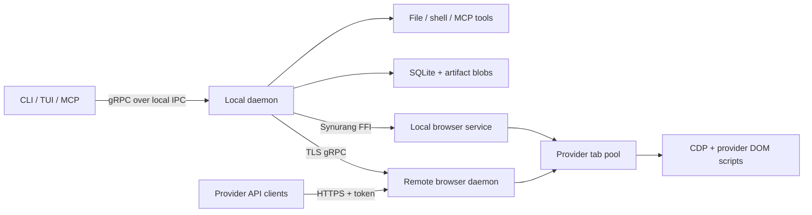

# Architecture

The CLI, TUI, and stdio MCP clients share a local daemon. It runs workspace tools and connects to either a local or remote browser host.

Only local IPC exposes workspace execution. File, shell, and external MCP tools stay on the workspace machine; browser operations run on the selected browser host. See [runtime and RPC](rpc.md).

## Code Map

| Area | Entry points |
|---|---|
| CLI and terminal UI | [cli.rs](../src/cli.rs), [tui/](../src/tui/) |
| Durable agent loop and tools | [agent_service.rs](../src/agent_service.rs), [agent/](../src/agent/) |
| Model requests and tab scheduling | [service.rs](../src/service.rs), [tab_pool.rs](../src/tab_pool.rs) |
| Providers and DOM adapters | [provider/](../src/provider/), [gemini.rs](../src/gemini.rs), [adapter.rs](../src/adapter.rs), [providers/](../providers/) |
| Chrome, CDP, and external browsing | [browser_host.rs](../src/browser_host.rs), [cdp.rs](../src/cdp.rs), [browser_control/](../src/browser_control/), [browser_network.rs](../src/browser_network.rs) |
| IPC, RPC, and public interfaces | [anticrumb.proto](../proto/anticrumb.proto), [rpc/](../src/rpc/), [http.rs](../src/http.rs), [mcp_sdk.rs](../src/mcp_sdk.rs) |
| Persistence and search | [store.rs](../src/store.rs), [knowledge.rs](../src/knowledge.rs) |

## Browser Sessions

Gemini reuses tabs per account to avoid repeated setup:

| Role | Lifetime and use |
|---|---|
| Master | Persistent conversation per workspace/session; no fixed workspace count limit |
| Worker | Shared temporary chats for delegated tasks and stateless requests; bounded by `--workers N` |
| System operation | Reuses an idle worker or opens a temporary overflow tab when workers are busy |

External browsing uses separate cookie contexts and bypasses provider model slots. Worker permissions and browser session limits are documented in [Tools](tools.md). Provider manifests and scripts are bundled; [overrides](../providers/README.md#updating-dom-scripts-without-rebuilding) allow website fixes without recompilation. Gemini models and thinking levels are discovered at runtime.

## State and Recovery

- Agent events and history persist in SQLite; artifact blobs are addressed by SHA-256. Local and remote browser backends have separate workspace stores.
- Conversations persist across turns. [Prompt attachments](usage.md#native-attachments-and-images) reduce browser input size without reducing model context usage.
- Prompt submission is journaled before sending. An uncertain submission is never replayed automatically; sign-in challenges retain their tab for human resolution. See [RPC recovery](rpc.md#key-rpc-behaviors).

For user-visible daemon lifetime and debugging, see [local IPC](rpc.md#local-ipc-lifecycle-and-recovery) and [runtime health](usage.md#runtime-health-and-debugging).
