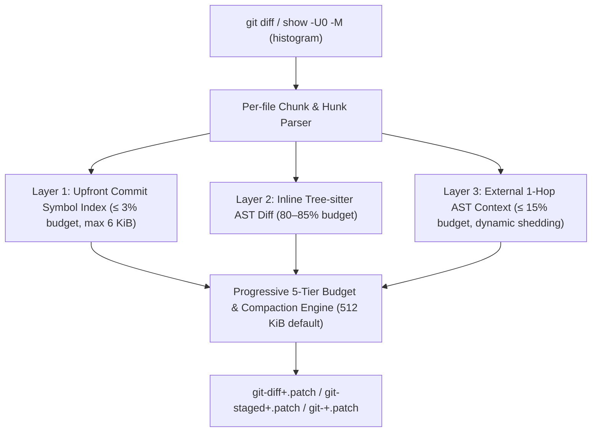

# 3-Layer Hybrid Git+AST Diff (`@git:diff+`, `@git:staged+`, `@git:<commit>+`)

`anticrumb` provides AST-expanded git patch attachments optimized for **1-turn LLM code review attention efficiency**. By combining `git diff` with LSP-free Tree-sitter AST analysis, `@git:diff+`, `@git:staged+`, and `@git:<commit>+` deliver self-contained patches without truncating production code (logging an advisory warning when output exceeds `512 KiB`, configurable via `ANTICRUMB_PATCH_BUDGET_KIB`).

---

## 1. Usage

Attach expanded diffs directly in Chat mode, Agent mode, or `anticrumb exec`:

```sh
# Unstaged working tree changes (index -> worktree) with 3-Layer Hybrid AST context
anticrumb exec -C ./project 'Review @git:diff+ for bugs and API contract regressions'

# Staged changes (HEAD -> index) with 3-Layer Hybrid AST context
anticrumb exec -C ./project 'Review @git:staged+ before committing'

# Any commit, tag, branch, or relative revision (<sha>, HEAD, HEAD~1, v0.8.4)
anticrumb exec -C ./project 'Review @git:HEAD+ and summarize risks'
anticrumb exec -C ./project 'Audit @git:575d269+ for platform edge cases'
```

| Mention | Source | Generated Attachment | Behavior |
|---|---|---|---|
| `@git:diff` | Unstaged (`git diff`) | `git-diff.patch` | Standard unified diff |
| `@git:staged` | Staged (`git diff --staged`) | `git-staged.patch` | Standard unified diff |
| `@git:<commit>` | Commit (`git show <commit>`) | `git-<sha>.patch` | Standard commit patch |
| **`@git:diff+`** | Unstaged + Tree-sitter Hybrid | `git-diff+.patch` | **3-Layer Hybrid AST diff** |
| **`@git:staged+`** | Staged + Tree-sitter Hybrid | `git-staged+.patch` | **3-Layer Hybrid AST diff** |
| **`@git:<commit>+`** | Commit + Tree-sitter Hybrid | `git-<sha>+.patch` | **3-Layer Hybrid AST diff** |

> **Resolution rule for trailing `+`:** When a `@git:<rev>+` mention ends with `+`, `anticrumb` resolves `<rev>` first and applies 3-Layer Hybrid AST expansion. If `<rev>` does not resolve as a valid git revision, it falls back to looking up a literal git ref named `<rev>+`.

---

## 2. 3-Layer Hybrid Output Architecture



### Layer 1 — Upfront Commit Symbol Index (`≤ 3%` of budget, capped at `6 KiB`)

Placed immediately before the first `diff --git` chunk to prime LLM KV cache attention with a compact map of changed files, line churn, compaction tags, and modified top-level symbols:

```text
[Symbol Index: 6 files, +515/-149]
  A .cargo/config.toml (+5/-0)
  M .github/workflows/build.yml (+5/-4)
  M install.ps1 (+11/-5)
  M src/update/mod.rs (+263/-2) — TARGET, format_target_label, format_download_target, plan_update, run
  M src/update/release.rs (+62/-10) — windows_x64_fallback, asset_filename, validate_exact_asset, validate_asset
  M xtask/tests/installer_contract.rs (+169/-128) — write_windows_fixture_zip, run_ps
```

- **Trivial diff suppression:** Omitted automatically for small single-file diffs (`< 120` lines churn and `< 4 KiB`) where a table of contents adds overhead.
- **200+ line new files:** Summarizes top-level AST definitions (`[large new]`) so reviewers see the file's structure upfront.
- **Production symbol priority:** Prioritizes modified production symbols over inline `#[cfg(test)]` test helper names, and switches to a ultra-compact file/tag format (`≤ 3 KiB`) when budget compaction triggers.

### Layer 2 — Refined Inline `git+ast` Diff (`80–85%` of budget)

Expands modified hunks to their enclosing AST function/method/type definitions while eliminating common attention traps:

1. **Visibility / Modifier-Only `[sig-only]` Folding:**
   - When a hunk only modifies visibility qualifiers, `export`, or non-semantic attributes (e.g., `fn foo(...)` → `pub(crate) fn foo(...)`, `protected` → `public`, adding `#[inline]`) with **zero body changes** and an unchanged body `≥ 25` lines (`SIG_ONLY_MIN_BODY_LINES = 25`), Layer 2 clamps the body to `-U3` instead of expanding dozens of unchanged lines:
     ```text
     @@ -17,4 +17,4 @@ pub(crate) fn compute_audit_checksum(seed: u64) -> u64 { [sig-only; body unchanged: 58 lines]
     ```
   - **Safety invariant:** Never folds hunks that alter parameter types, return types, function names, semantic attributes (`#[cfg(...)]`, `#[no_mangle]`), or `async`/`unsafe`/`static`/`const`/`extern`/`default` qualifiers (keeping the full body visible to expose downstream cast/type hazards).
2. **`[clamped]` Header Full Parameter Preservation:**
   - When an oversized function (`> 220` lines in production files, `> 40` lines in test files) is clamped around the changed lines and its declaration header is cut off, the `@@` hunk header greedily preserves parameters up to **200 characters** instead of aggressively truncating at the first parameter (`...`), keeping nullability, types, and flags visible.
3. **Named `[+ sym1, sym2]` Merged Hunk Headers:**
   - When adjacent hunks merge across multiple definitions, `@@` headers list the actual bare symbol names (`[+ ProcessRefund, ValidatePolicy]`) within budget instead of opaque `(+N more)` counters.
4. **Multi-Language Grammar & UTF-8 Safety:**
   - Uses `" › "` as the parent-to-member scope separator (`class OrderController › @Transactional public boolean placeOrder(...)`) so it never collides with `->`, `=>`, or generic `<T>` syntax.
   - Preserves security and semantic decorators/annotations (`@Transactional`, `[Authorize]`, `[HttpPost(...)]`, `@classmethod`, `#[must_use]`) in hunk signature previews.
   - All byte slicing and truncation strictly respects UTF-8 character boundaries.

### Layer 3 — Lightweight External 1-Hop AST Context (`≤ 15%` of budget, LSP-free)

Appended at the end of the patch under `=== External AST Context (1-hop, unmodified) ===`, extracting **only unmodified internal symbols directly referenced by changed code** (including identifiers referenced on deleted `-` lines):

```text
=== External AST Context (1-hop, unmodified) ===
--- same-file: src/store/cache.rs ---
// L16-L16
const TEMP_AGE_MS: i64 = 24 * 3600 * 1000;
--- cross-file: src/domain.rs ---
// L5-L5
pub const MAX_ARTIFACT_BYTES: u64 = 100 * 1024 * 1024;
--- cross-file: src/settlement.rs ---
L19: pub fn reserve_funds(account_id: u64, amount_cents: u64, timeout_ms: u64, idempotency_key: &str) -> Result<Reservation, SettlementError>
  // doc: Reserves funds in **cents** (NOT whole dollars!). `timeout_ms` must be in milliseconds (minimum 1000 ms).
```

- **Layer 3-① (Same-File Unmodified Types & Constants):**
  - Reuses the already-parsed Tree-sitter AST (`0 ms` extra parse cost) to extract unmodified top-level/module-level `struct`, `enum`, `interface`, `type`, `record`, `class`, and `const` definitions referenced by changed hunks.
  - Excludes inline `#[cfg(test)]` test blocks and function-local inner constants.
- **Layer 3-② (Snapshot-Safe 1-Hop Forward Cross-File Types & Signatures):**
  - Resolves diff-referenced imports (`use`, `import`, `from ... import`, `#include`, `using`, `require_relative`) and same-package sibling files across the repository.
  - **Snapshot accuracy:** Reads target blobs via a single batched `git cat-file --batch` pipe bounded by `8s` timeout for `Commit(sha)` and `Staged` diffs (and bounded `fs::read` for `Unstaged`), guaranteeing historical and staged accuracy without touching dirty worktree files.
  - **Body-stripped signatures + concise doc comments:** Emits function/method signatures with bodies stripped, plus up to `160 B` of leading doc comments (`///`, `/** ... */`, `//`, `#`) or Python first-statement docstrings (`"""..."""`) as `// doc: ...`.
- **Layer 3-③ (Snapshot-Safe 1-Hop Reverse Callers & Type Consumers):**
  - Detects unmodified production callers across the repository whose calls, constructor sites, JSX usages, or type references target modified/deleted production functions or types (`git grep -n -z -F -I` + batched `git cat-file --batch` + Tree-sitter AST verification).
  - Supports both ASCII identifiers (`-w`) and non-ASCII/UTF-8 identifiers (e.g., Korean symbols, Ruby `?`/`!` methods) while ignoring comments, string literals, imports, and test scopes (`tests/`, `#[test]`, inline `#[cfg(test)]` blocks).
  - Prioritizes signature-changed / type targets and explicit import/same-package pinned callers within a strict 6-tier budget order.
- **Strict noise discipline:** Filters out untouched top-of-file imports, stdlib/external packages, test files, and ambiguous unpinned symbols (`> 2` candidate files). Deterministic candidate cap (`24` files) and `2 MiB` total parse byte ceiling; file-scoped `(norm_path, symbol_name)` deduplication ensures modifying `a::sym` never suppresses external `b::sym`.
- **Automatic budget shedding:** When a massive diff triggers production code compaction (Tier 3+) or leaves `< 2 KiB` of headroom on diffs `> 256 KiB`, cross-file forward & reverse resolution is skipped automatically (`0 ms` overhead) so Layer 3 never starves modified production code.

---

## 3. Supported Languages (13 Built-In Tree-sitter Grammars)

| Language | Extensions | Layer 1/2 AST Expansion | Layer 3-①/② Extraction & Import Resolution |
|---|---|---|---|
| **Rust** | `.rs` | `fn`, `struct`, `enum`, `trait`, `impl`, `const`, `mod` | `use crate/super/self`, `mod foo;`, `///` docs |
| **Python** | `.py`, `.pyw` | `def`, `async def`, `class`, `@decorator` | `import`, `from ... import`, inline `"""docstring"""` & `#` |
| **TypeScript / TSX** | `.ts`, `.tsx`, `.mts`, `.cts` | `function`, `class`, `interface`, `type`, `enum`, methods | Relative `./`/`../`, `@/`/`~/`, & CommonJS `require(...)`, JSDoc `/** */` |
| **JavaScript / JSX** | `.js`, `.jsx`, `.mjs`, `.cjs` | `function`, `class`, methods, arrow bindings | Relative ES `import` & CommonJS `require(...)`, JSDoc `/** */` |
| **Go** | `.go` | `func`, method receivers, `type struct/interface` | Same-directory package siblings + internal package imports, `//` docs |
| **Java** | `.java` | `class`, `interface`, `enum`, `record`, methods, `@Annotation` | `import pkg.Type;` + same-package siblings, JavaDoc `/** */` |
| **C#** | `.cs` | `class`, `struct`, `interface`, `enum`, `record`, methods, `[Attr]` | `using Namespace;` + same-directory siblings, `/// <summary>` docs |
| **C / C++ / CUDA** | `.c`, `.h`, `.cc`, `.cpp`, `.hpp`, `.cxx`, `.hxx`, `.cu`, `.cuh` (plus `.inc` via priority gate) | `fn`, `struct`, `class`, `enum`, `namespace`, templates | `#include "..."` + paired header/source siblings, `///`/`/** */` |
| **Ruby** | `.rb` | `class`, `module`, `def`, `def self.foo` | `require_relative`, `require`, `#` docs |
| **Bash / JSON** | `.sh`, `.bash`, `.json` | Enclosing function / key expansion (Layer 2) | Excluded from Layer 3 cross-file resolution |

Extension mappings are declared in `src/tree_sitter_diff/extensions.json`:
- **`exact`**: unambiguous 1:1 extension-to-language mappings parsed directly (including `.cu`/`.cuh` mapped to `cpp`).
- **`priority`**: ambiguous extensions mapped to an ordered list of candidate languages (e.g. `"inc": ["cpp"]`, extensible to `["cpp", "php", ...]`). Candidates are tried in priority order and validated via Tree-sitter's AST `ERROR`/`MISSING` nodes; if no candidate parses cleanly, the file falls back to `git diff -W` with a non-fatal warning.
- **`plain_diff`**: non-code documentation, text, and config extensions (`.md`, `.txt`, `.yml`, `.yaml`, `.toml`, `.csv`, etc.) attached directly as clean `-U3` unified diffs with zero fallback warnings.

Other unsupported file extensions automatically fall back to `git diff -W` (function context) with a non-fatal warning.

---

## 4. Pre-Omission & Size Warning (Plus Explicit-Budget Compaction Engine)

By default, `@git:diff+`, `@git:staged+`, and `@git:<commit>+` apply noise pre-omission (Tier 1 lockfiles/minified/generated files and large new test summaries) without truncating production code, and log a warning when the resulting patch exceeds `ANTICRUMB_PATCH_BUDGET_KIB` (default `512 KiB`, clamped `16`–`16384 KiB`). When an explicit byte budget is supplied via `generate_expanded_diff_with_config` (used by `diff_ab_bench` and compaction tests), `apply_patch_budget_with_hybrid` degrades non-essential content in five progressive tiers before truncating modified production code:

1. **Tier 1 (Pre-Omission):** Lockfiles (`Cargo.lock`, `package-lock.json`, etc.), minified bundles (`*.min.js`, `*.map`), and generated code (`@generated`, protobuf/codegen outputs) are replaced with 1-line summaries.
2. **Tier 2 (Test Compaction):** Large new test files are summarized with a symbol index; modified test files and inline `#[cfg(test)]` blocks degrade to `-U3` / `-U0` or fold before production files are touched.
3. **Tier 3 (Production `-U3` Degradation):** Largest expanded production chunks degrade from full-function AST context to compact `-U3` hunks (preserving AST signatures in `@@` headers). Layer 3 cross-file context is shed automatically.
4. **Tier 4 (Large New File Skeletonization):** Newly added production files (`≥ 200` lines) fold function bodies to `{ /* ... */ }` skeletons while keeping all type definitions and function signatures intact.
5. **Tier 5 (Water-Filling Head/Tail Truncation):** As a last resort, remaining oversized chunks are water-filled with head/tail line maps.

---

## 5. Pure-Rust Multi-Arm Ablation & External Baseline Suite

A zero-Python benchmark harness is built into `xtask` and `tools/test/ab-bench` for regression testing, external baseline comparisons (`P0`: `-U3`, `P1`: `-W`, `P2`: `-U3` + snapshot full files), and ablation experiments (`A: off`, `B1: l1,l2`, `B2: l1,l2,l3_local`, `B3: +l3_cross`, `B4: full` with reverse callers):

```sh
# 1. Generate multi-language seeded-bug fixtures (Rust, TS, Python, Go, Java, C#, C++, Ruby + UTF-8 reverse callers)
./tools/test/ab-bench fixtures --out /tmp/anticrumb_ab/fixtures

# 2. Run Multi-Arm offline ablation on real repository commits + fixtures
./tools/test/ab-bench offline \
  --commits 575d269,b1bbdab,5aca67c,85c359b,86d4ef9@512,86d4ef9@128 \
  --fixtures-dir /tmp/anticrumb_ab/fixtures \
  --arms P0,P1,P2,A,B1,B2,B3,B4 \
  --out /tmp/anticrumb_ab/run1

# 3. Grade structured JSON code-review outputs against ground-truth rubrics
./tools/test/ab-bench grade \
  --rubrics /tmp/anticrumb_ab/fixtures/rubrics.json \
  --runs-dir /tmp/anticrumb_ab/run1/llm
```
